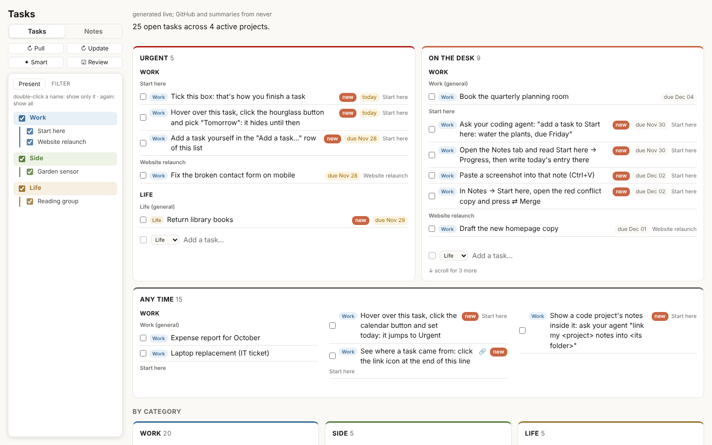
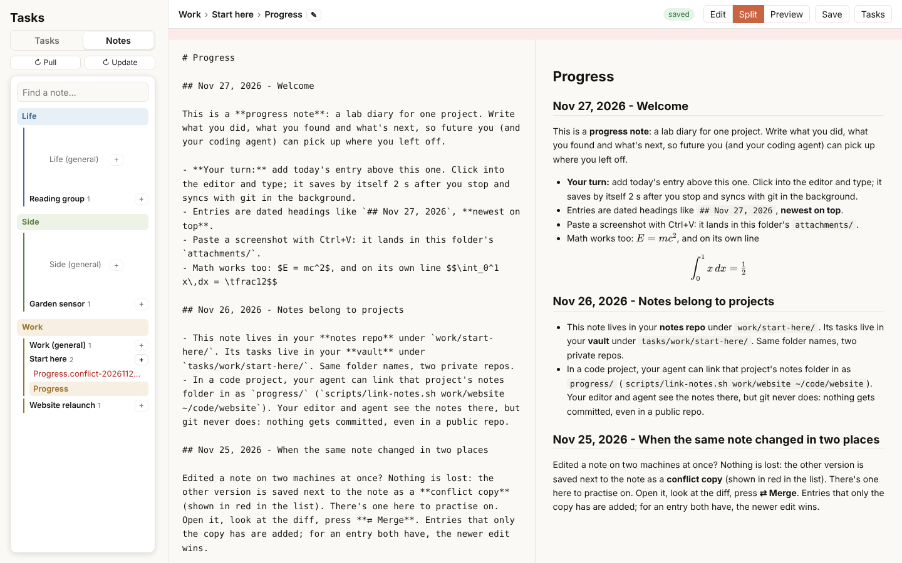
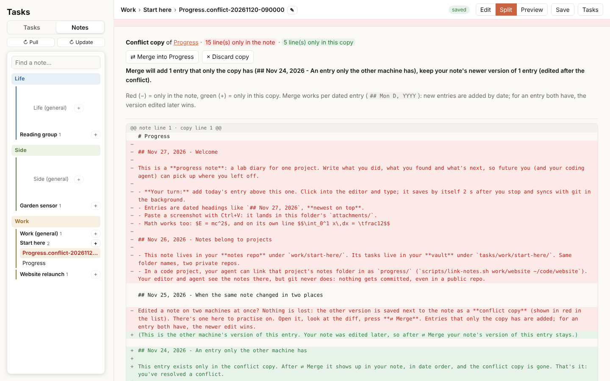

# Task dashboard kit

> **🚀 Quick setup: paste this into your coding agent** (Codex, GitHub Copilot, Cursor,
> Gemini CLI, Claude Code, …) and it sets everything up with you, step by step:

```text
Set up the task dashboard kit for me: https://github.com/Ner-Ber/task-dashboard-kit

1. Clone it to ~/task-dashboard-kit (or use it if it's already there), then read its
   AGENTS.md and README.md and follow them. They are the source of truth.
2. Check the requirements: git, python3 >= 3.11, uv (gh is optional, needed for GitHub
   repos and project activity). If something is missing, tell me how to install it on my
   system and wait until I have.
3. Ask me these in ONE message, with the defaults in brackets:
   a. Start with the guided tour and sample data, or empty lists? [tour + sample data]
   b. Only if empty lists: my task categories as folder:Label pairs
      [work:Work,side:Side,life:Life] and which code projects (local folders) should
      show their progress notes. (With the tour, the last tour task sets these up.)
   c. My GitHub username, so my tasks and notes get their own PRIVATE repos and sync
      between machines [recommended; skip = local only].
   d. Which coding agent(s) I use.
4. Copy .env.example to .env. Only for empty lists, set CATEGORIES from my answer.
5. Run scripts/init-data-repos.sh (add --empty and/or --github <user> per my answers).
   Any GitHub repos it creates must be PRIVATE; check that and tell me.
6. Install the agent skills for my agent(s) with scripts/install-skills.sh (see the
   README's agent table).
7. Start the dashboard with scripts/open-dashboard.sh and give me the link. On Windows
   with WSL, offer scripts/install-windows-shortcuts.sh for a desktop shortcut.
8. Only for empty lists: set up each code project as in AGENTS.md ("Your own projects")
   and show me that `git status` in each project is clean.
9. Finish with a short summary: where everything lives and how to open the dashboard.
   With the tour: tell me to work through the "Start here" tasks at the top of the
   dashboard, and help with each one when I ask (AGENTS.md, "The Start here tour").

Rules: never put my tasks or notes into a code repo or into the kit, never commit .env
or tokens, and ask me instead of guessing.
```

Prefer to do it by hand? Follow the [Quick start](#quick-start) below.

| Tasks | Progress notes |
|---|---|
| <a href="docs/images/tasks.png"><picture><source media="(prefers-color-scheme: dark)" srcset="docs/images/tasks-dark.png"></picture></a> | <a href="docs/images/notes.png"></a> |

New users get a **Start here** project (above) that is the tutorial: each task shows one
feature, from ticking a box to linking notes into a code project, and the last one
removes the sample data. Notes even include a practice edit conflict:

<a href="docs/images/conflict.png"></a>

A personal **task dashboard** plus **progress notes** that show up inside your code
projects, managed by you in a browser and by any coding agent (Codex, Copilot,
Cursor, Gemini CLI, Claude Code) through plain markdown files in git.

- **Tasks**: markdown checklists in a private git repo (the *vault*), one list per
  category and per project. The dashboard sorts them into **Urgent / On the desk /
  Any time** by due date, with a card per project (and its GitHub activity).
- **Progress notes**: a lab-diary per project in a second private repo, with a
  browser editor (live preview, image paste, math) that autosaves and syncs.
- **Notes in code repos**: `progress/` inside any code repo links to that project's
  notes. It's hidden from git locally, so even a public repo stays clean.
- **Agents**: `AGENTS.md` plus two Agent Skills (`vault-tasks`, `vault-notes`) teach
  any agent the formats.

How it fits together: [docs/ARCHITECTURE.md](docs/ARCHITECTURE.md).

## Requirements

`git`, `python3` ≥ 3.11 and [`uv`](https://docs.astral.sh/uv/) (runs the dashboard,
no other Python packages). Optional: the GitHub CLI `gh` (project activity, creating
your private repos). Works on Linux, macOS and Windows via WSL. Native Windows: the
dashboard runs with Python, and the scripts have PowerShell or WSL equivalents.

## Quick start

### 1. Get the kit

On GitHub: **Use this template → Create a new repository** (keep it private if you
like), then clone it. Or simply:

```bash
git clone https://github.com/<you>/task-dashboard-kit.git ~/task-dashboard-kit
cd ~/task-dashboard-kit
```

### 2. Create your vault and notes repos

From the templates, with sample data and the **Start here** tour (recommended the first time):

```bash
scripts/init-data-repos.sh
```

…or start clean, with one empty list per category:

```bash
scripts/init-data-repos.sh --empty
```

This creates `~/assistant/vault` and `~/assistant/notes` (two separate git repos),
installs the agent skills into the vault, and writes `.env` from `.env.example`.
To also create **private** GitHub repos and push (recommended: GitHub is how your
machines and agents sync):

```bash
gh auth login
scripts/init-data-repos.sh --github <your-github-user>
```

### 3. Configure

Edit `.env` (every variable is explained in `.env.example`). Most people only
change the categories:

```bash
CATEGORIES=work:Work,side:Side,life:Life
```

### 4. Run the dashboard

```bash
scripts/open-dashboard.sh
```

It serves http://127.0.0.1:8765/ (loopback only, nothing is exposed) and opens your
browser. `--no-browser` for headless, `--restart` after updating the kit. Directly:

```bash
uv run app/dashboard.py serve --vault "$HOME/assistant/vault"
```

Try it: tick a task, add one in a list's "Add a task…" row, open **Notes**, edit
*Website relaunch → Progress* and paste a screenshot. Every change is a git commit
in your vault or notes repo. Press **↻ Update** to refresh GitHub activity.

**Optional, with the Claude Code CLI** (`claude`, logged in, with its Gmail and Google Calendar
connectors): **✦ Smart** adds today's headline, your calendar, emails waiting for a reply and
proposed tasks (read-only; you accept each proposal). **☑ Review** builds a weekly review of
stale, overdue, duplicate and likely-done tasks. Without `claude` everything else works.

**Windows (WSL)**: `scripts/install-windows-shortcuts.sh` adds a "Tasks" Desktop/Start
Menu shortcut, plus autostart on login.

### 5. Set up your agent

Agents read `AGENTS.md` in the kit, and the skills tell them how to edit tasks and notes.
Project-level skills are already in your vault (`.agents/skills/`, `.claude/skills/`).
To use them everywhere:

```bash
scripts/install-skills.sh --user
```

| Agent | Instructions file | Skills location (project / user) |
|---|---|---|
| **Codex** | `AGENTS.md` (read automatically) | `.agents/skills/` / `~/.agents/skills/` |
| **GitHub Copilot (VS Code)** | `AGENTS.md` (read automatically; also `.github/copilot-instructions.md`) | `.github/skills/` (also reads `.agents/skills/`, `.claude/skills/`) / `~/.copilot/skills/` |
| **Cursor** | `AGENTS.md` (read automatically) | `.cursor/skills/` or `.agents/skills/` / `~/.cursor/skills/` |
| **Gemini CLI** | `.gemini/settings.json` → `context.fileName: ["AGENTS.md"]` (included) | `.gemini/skills/` or `.agents/skills/` / `~/.gemini/skills/`. Skills may need enabling via `/settings` |
| **Claude Code** | `CLAUDE.md` = `@AGENTS.md` (included) | `.claude/skills/` / `~/.claude/skills/` |

Paths follow each tool's docs as of 2026-11 ([Codex](https://developers.openai.com/codex/skills),
[VS Code](https://code.visualstudio.com/docs/agent-customization/agent-skills),
[Cursor](https://cursor.com/docs/context/skills), [Gemini CLI](https://geminicli.com/docs/cli/skills/)).
They move fast, so check there if a skill doesn't load. `install-skills.sh <repo> --github`
also writes `.github/skills/` for the Copilot cloud agent.

Chat assistants without a checkout (claude.ai, ChatGPT, …) can use the same `SKILL.md`
files with their GitHub connector pointed at your vault/notes repos.

### 6. Show a project's notes inside its code repo

```bash
scripts/link-notes.sh work/website ~/code/website
```

```powershell
scripts\link-notes.ps1 work\website C:\code\website
```

This creates `~/code/website/progress/` → your notes folder, and adds `/progress` to that
repo's `.git/info/exclude` (local only). Check, and undo:

```bash
git -C ~/code/website status
```

```bash
scripts/link-notes.sh --unlink ~/code/website
```

`git status` stays clean. **Windows**: symlinks need **Developer Mode** (Settings →
System → For developers) or an admin shell, and `link-notes.ps1` falls back to a
directory junction otherwise. Inside WSL, `link-notes.sh` just works.

**Coding on another machine** (a server, a cluster, a second laptop)? Paste
`templates/notes/.notes/agent-setup-prompt.md` (also in your notes repo under
`.notes/`) into your agent there. Replace `<OWNER>/<NOTES_REPO>` first. It clones the
notes repo, makes the `progress/` link, adds an agent rule, and sets up hooks or cron
that keep notes synced. It's written for Cursor; other agents follow it fine, and
their hook mechanisms differ.

## Day to day

- Add tasks in the dashboard, or ask an agent ("add a task to the website project: …").
- Write progress notes in the Notes tab, or in `progress/` from your editor. Newest
  entry on top, `## Nov 20, 2026` style.
- Sync is git: the dashboard commits and pushes for you, and on other machines run
  `.notes/sync.sh` (or let the hooks/cron do it).

## Privacy

Your vault and notes are private repos, the kit holds no personal data, and code repos
only ever get a git-ignored link. Details and the "keep a public repo clean"
checklist: [docs/ARCHITECTURE.md#privacy](docs/ARCHITECTURE.md#privacy).

## Updating / contributing

`docs/UPDATING.md` explains how the maintainer exports improvements from their own
setup into this kit (allowlist + generalize + privacy check). Run the tests with:

```bash
uv run --with pytest pytest -q tests/
```

## Not included (possible extensions)

- **Other agents for ✦ Smart / ☑ Review**: those two buttons call the `claude` CLI. Swapping
  in another agent CLI (Codex, Gemini) would need a small adapter in `app/dashboard.py`
  upstream. Not built yet.
- **Chat/MCP server**: an MCP server exposing `add_task` / `list` / `complete` would let
  chat assistants use tasks without a GitHub connector. Not built yet.
- **Phone access**: the dashboard is loopback-only by design. For a phone, put it
  behind a private tunnel with auth (e.g. Tailscale Serve), never a public port.
- Telegram bot, mail integration, calendar: not part of this kit.

## Licenses

Vendored front-end libraries keep their own licenses: see `app/static/vendor/README.md`
(marked: MIT, DOMPurify: Apache-2.0/MPL-2.0, KaTeX: MIT).
