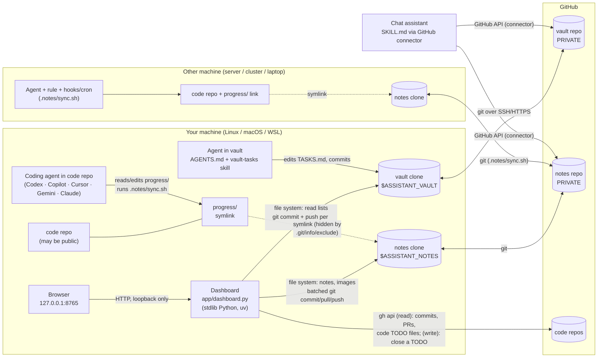

# Architecture

Four kinds of repositories, one local web app, and plain-file conventions that every
agent can follow. No server, database or cloud service of its own: **git is the
storage and the sync layer**, GitHub is the shared remote, and the dashboard runs on
your own machine.

## Components

| Component | Where | Notes |
|---|---|---|
| **Dashboard** | `app/dashboard.py` in this kit, run on your machine | One file, Python standard library only, HTML/CSS/JS inside. The Notes page and vendored JS (marked, DOMPurify, KaTeX) are in `app/static/`. Serves `127.0.0.1` only. |
| **Launcher** | `scripts/open-dashboard.sh` | Loads `.env`, starts `serve` if needed, opens the browser, fast-forwards the kit checkout to `origin/main` on each launch (`DASHBOARD_NO_AUTO_UPDATE=1` turns that off). Windows: `scripts/install-windows-shortcuts.sh` adds Desktop/Start/autostart shortcuts that call it through WSL. |
| **Vault** | private git repo, local clone at `$ASSISTANT_VAULT` | Task lists, project metadata, inbox. Generated cache in `dashboard/`. |
| **Notes repo** | private git repo, clone at `$ASSISTANT_NOTES` (default: `notes/` next to the vault) | One folder per project, `attachments/` for images, `PROJECTS.md` index, `.notes/sync.sh`. Separate from the vault so a coding machine can get notes without your tasks. |
| **Code repos** | anywhere | Untouched. They only get a local `progress/` link. |
| **Agents** | wherever you code | `AGENTS.md` (+ `CLAUDE.md`, `.gemini/settings.json`), skills `vault-tasks`, `vault-notes`. |

## Infra ↔ tasks

- **Storage**: markdown files in the vault clone (`TASKS.md`, `tasks/<category>/…/TASKS.md`).
  The dashboard never keeps its own database; `dashboard/data.json` is a cache.
- **Reading**: on every page load the dashboard re-reads the files, after at most one
  `git pull --rebase --autostash` per minute.
- **Writing**: every action (done, due, snooze, add, move, urgency) edits the line in
  place, then `git commit` + `git push` (one commit per action, so it can be undone).
  If a push is rejected it pulls and retries.
- **↻ Update** pulls, gives new tasks a `🆔`, fetches GitHub activity, rebuilds the cache.
- **✦ Smart** and **☑ Review** (optional, need the Claude Code CLI `claude`, logged in):
  - ✦ Smart runs Update, then one **read-only** Claude pass over the vault, Gmail and Google
    Calendar (the Claude account's Gmail/Calendar connectors). It fills today's headline,
    the calendar, emails waiting for your reply, and proposed tasks / likely-done tasks.
    Claude only returns JSON; the dashboard validates it and nothing is added until you
    accept a proposal.
  - ☑ Review finds overdue, stale (30+ days untouched), duplicate and likely-done tasks,
    old PRs and quiet projects, and has Claude turn them into questions. Done / drop / snooze /
    "still open" apply directly as normal task edits ("still open" stamps `👀` today);
    free-text answers are recorded for you to act on with your agent.
  - Without `claude` these buttons just report that it's missing; everything else works.
    Other agents don't plug in here yet (see the README's extensions).
- **Sources**: a task can carry `🔗 <ref>` (Gmail thread, Sheet, Doc, Drive file, URL or
  vault note); the dashboard shows it as a link. Proposals from ✦ Smart get one automatically.
- **Credentials**:
  - **git**: your normal SSH key or HTTPS credential for the private vault/notes repos.
    To scope it down on a shared machine, use a **deploy key** per repo (Settings → Deploy
    keys, write access) instead of your personal key.
  - **GitHub API** (optional, project cards): the `gh` CLI's own login or `GH_TOKEN`.
    Minimal fine-grained token: *Metadata* + *Contents: read* + *Pull requests: read*
    on just the code repos you link; *Contents: write* only if you close code TODOs
    from the dashboard. The dashboard never needs access to repos you don't link.
  - **No auth on the dashboard itself**: it binds `127.0.0.1` and checks the `Host`
    header (no DNS-rebinding) and `Origin` (no cross-site POSTs). Don't expose the port.
    For phone access use a private tunnel with its own auth.

## Tasks ↔ progress notes

- **Same folder names, different repos.** The vault list `tasks/work/website/TASKS.md`
  and the notes folder `work/website/` belong to the same project. Every folder that has
  a `TASKS.md` (category or project) can have notes, so creating a project in the
  dashboard (select tasks → Project… → New project…) also makes its notes folder available.
- **Notes**: `<folder>/<Note>.md`, any number per project. Dated entries `## Mon D, YYYY`,
  newest on top.
- **Images**: pasted or dropped in the dashboard, shrunk in the browser to WebP
  (≤ 1600 px, quality 0.85; the original is kept if already smaller), and stored as
  `<folder>/attachments/YYYY-MM-DD-HHMMSS.webp`. The note gets ``. The
  server accepts only webp/png/jpeg/gif with matching magic bytes, ≤ 15 MB.
- **Code link**: `memory/projects/<slug>.md` has `**Repo:** \`owner/name[@branch]\``.
  The dashboard writes `PROJECTS.md` in the notes repo (folder ↔ name ↔ repos) on every
  notes sync, so an agent inside a code repo can find "its" notes folder.
- **Where it shows**: the **Tasks** page shows lists and project cards (with repo
  activity and code TODO files: `*todo*.md` checklists/item blocks, or plain-text `*todo*.txt`
  with one `# item` per line). The **Notes** tab shows a projects → notes tree,
  editor + preview, and an optional panel with that project's open tasks.
- **Saving and sync**: the editor saves to disk 2 s after you stop typing, then commits
  in batches (after 60 s idle, on switching notes, leaving the tab, or Save/Ctrl+S),
  then pull --rebase + push. **Conflicts never lose text**: if a note changed elsewhere,
  your text stays in the note and the other version is saved beside it as
  `<note>.conflict-<timestamp>.md`. The UI shows a red banner with a **diff view**,
  **⇄ Merge** (per dated entry: entries only in one version are kept, for the same date the
  newer edit wins) and **× Discard**. `.notes/sync.sh` uses the same policy on other machines.
- **Security**: every notes path is resolved inside its project folder: only
  `<Note>.md` and `attachments/<file>`, no `..`, absolute paths or symlinks.

## Notes ↔ code repos

- **Mechanism**: `scripts/link-notes.sh <folder> <code-repo>` creates
  `<code-repo>/progress` → `$ASSISTANT_NOTES/<folder>` (a symlink; on native Windows
  `link-notes.ps1` makes a symlink with Developer Mode/admin, else a junction).
- **Why nothing gets committed**: the script appends `/progress` to the repo's
  `.git/info/exclude`. That file is git's *local* ignore list. It lives inside `.git/`,
  is never committed or pushed, and isn't shared with collaborators. `.gitignore` is NOT
  used, because it's a tracked file and would advertise the link in the repo.
  `git rev-parse --git-path info/exclude` finds the right file in worktrees too. The
  script refuses if `progress` is already tracked or already exists.
- **Verify**:
  - `git status --porcelain --untracked-files=all -- progress` prints nothing.
  - `git check-ignore -v progress` names `.git/info/exclude`.
- **Remove**: `scripts/link-notes.sh --unlink <code-repo>` deletes the link (never the
  notes) and the exclude line.
- **Another machine**: clone the notes repo there and link the same way, or paste
  `.notes/agent-setup-prompt.md` into the agent. It does the clone, link, an agent
  rule (also excluded), user-level hooks that run `.notes/sync.sh` after note edits,
  and optionally a cron job.

## Agents ↔ everything

| Situation | How the agent knows what to do | Needs |
|---|---|---|
| Agent opened **in the kit** | `AGENTS.md` (Codex, Copilot, Cursor read it natively; Claude via `CLAUDE.md` → `@AGENTS.md`; Gemini via `.gemini/settings.json`) | nothing else |
| Agent opened **in the vault** | the skills installed there (`.agents/skills/`, `.claude/skills/`) by `init-data-repos.sh`; `vault-tasks` describes the formats | git push access to the vault |
| Agent **in a code repo** | the `progress/` link + (optionally) the user-level skills (`install-skills.sh --user`) or the rule written by the agent-setup prompt | the notes clone on that machine; nothing in the code repo's git |
| **Chat assistant** (no checkout) | the same `SKILL.md` uploaded as a skill/instructions; it edits files through a GitHub connector | connector access to the private vault/notes repos only |

Agents follow the same rules as the dashboard: small commits to `main`, never
force-push, never copy notes into code repos.

## Privacy

**Private, always**: the vault repo, the notes repo, `.env`, your GitHub tokens/keys,
and the machine-specific link map (`~/.config/assistant/notes-links.toml`).

**Never commit**:
- vault or notes content (tasks, notes, images, excerpts) into any code repo,
  including in commit messages, PR descriptions, issues, CI logs or test fixtures
- `progress/`, or a `.gitignore` line that names it
- `.env`, tokens, private keys

**Keeping a public code repo clean**:
1. Link notes only with `link-notes` (it uses `.git/info/exclude`).
2. Before pushing: `git status` shows no `progress/`, and
   `git log -p origin/main..HEAD | grep -i progress/` finds nothing.
3. Don't let agents run `git add -A` in a repo with a link unless the exclude line is there.
4. Agent rule files that mention your notes (e.g. `.cursor/rules/progress-notes.mdc`)
   go into `.git/info/exclude` too, or into user-level config.
5. If something slipped into a pushed commit, removing the file isn't enough: rewrite
   history or treat the content as public.

**This kit** contains no personal data. `scripts/privacy-check.sh` scans for tokens,
private keys, e-mail addresses, home paths and a private denylist you keep outside the
repo (`~/.config/task-dashboard-kit/denylist.txt`). The test suite runs it.
