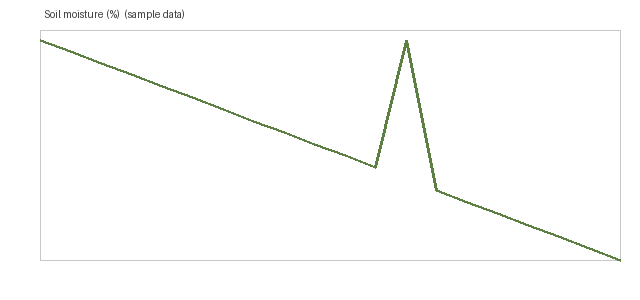

# Progress

## {{h-4}}

- First overnight log. Moisture drops slowly, then jumps after watering:

- Calibration idea: map raw readings $r$ to moisture $m = \frac{r - r_{dry}}{r_{wet} - r_{dry}}$.

## {{h-11}}

- Sensor wired and reading; values are noisy near the USB cable.
